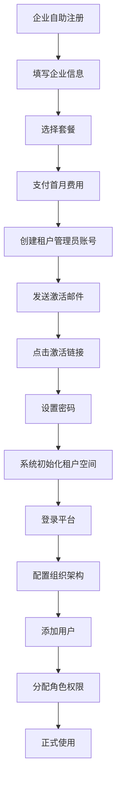
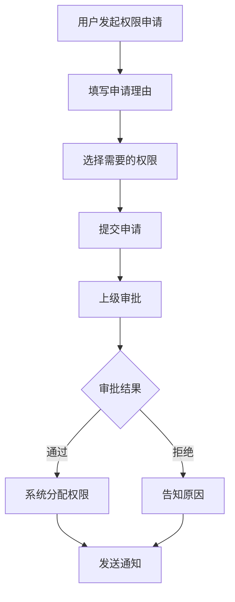
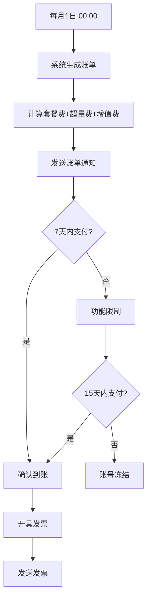

# B端SaaS功能设计文档 - 能源电力交易平台

## 一、产品概述

### 1.1 产品背景

随着电力市场化改革的深入，越来越多的能源企业、发电集团、售电公司需要一个统一的SaaS平台来管理电力交易业务。传统的本地化部署模式存在以下痛点：

| 痛点 | 说明 |
|------|------|
| **部署成本高** | 每个企业单独部署服务器，硬件+软件成本高 |
| **数据隔离难** | 多企业共用系统时，数据安全和隔离存在挑战 |
| **运维复杂** | 每个企业独立运维，更新迭代效率低 |
| **扩展困难** | 业务增长时难以快速扩容 |
| **成本不透明** | 前期投入大，ROI难以评估 |

为解决以上痛点，我们设计了**多租户SaaS架构**的能源电力交易平台，支持按订阅付费，灵活扩展。

### 1.2 产品目标

| 目标 | 指标 | 说明 |
|------|------|------|
| **租户规模** | 100+企业租户 | 覆盖发电、售电、用户侧等多类型客户 |
| **用户规模** | 1000+活跃用户 | 每个租户平均10+用户 |
| **可用性** | 99.9%+ | 保证平台稳定运行 |
| **数据隔离** | 100%安全 | 租户间数据完全隔离 |
| **成本降低** | 60%+ | 相比传统部署模式 |

### 1.3 用户角色体系

| 角色层级 | 角色名称 | 核心职责 |
|---------|---------|---------|
| **平台层** | 平台管理员 | 租户管理、系统配置、全局监控 |
| **租户层** | 租户管理员 | 用户管理、权限配置、账单管理 |
| **业务层** | 交易主管 | 交易策略审批、团队管理 |
| **业务层** | 交易员 | 电力交易操作、数据查询 |
| **业务层** | 财务人员 | 账单查看、发票管理 |
| **业务层** | 普通用户 | 数据查看、基础操作 |

---

## 二、核心功能模块设计

### 2.1 租户管理模块

#### 2.1.1 功能概述

管理平台所有企业租户，支持租户创建、配置、禁用/启用、数据隔离等核心功能。

#### 2.1.2 功能细节

| 功能 | 描述 |
|------|------|
| **租户创建** | 支持手动创建和自助注册两种方式 |
| **租户配置** | 配置租户名称、行业类型、规模、联系人等信息 |
| **租户状态** | 正常/试用/禁用/欠费四种状态管理 |
| **数据隔离** | 数据库层面完全隔离（Schema隔离模式） |
| **配额管理** | 配置租户的用户数、场站数、数据存储量等配额 |
| **租户到期** | 到期提醒、续费提醒、过期处理 |
| **租户数据导出** | 支持租户数据全量导出（合规要求） |

#### 2.1.3 租户状态流转

```
创建 → 试用 → 正式（付费） → 禁用
          ↓
        欠费（临时禁用）
```

#### 2.1.4 租户创建流程

```
平台管理员手动创建 / 企业自助注册
  ↓
填写租户基本信息（企业名称、行业、规模）
  ↓
选择订阅套餐（基础版/专业版/企业版）
  ↓
配置初始配额（用户数、场站数、存储量）
  ↓
创建租户管理员账号
  ↓
发送激活邮件
  ↓
租户激活，系统初始化租户数据空间
  ↓
租户管理员登录，开始使用
```

#### 2.1.5 数据隔离方案

| 隔离方案 | 说明 | 适用场景 |
|---------|------|---------|
| **Schema隔离** | 每个租户独立数据库Schema | 中大型租户，数据安全要求高 |
| **行级隔离** | 同一Schema，通过tenant_id区分 | 小型租户，成本敏感 |
| **混合模式** | 大客户Schema隔离，小客户行级隔离 | 灵活平衡成本与安全 |

---

### 2.2 权限体系模块

#### 2.2.1 RBAC权限模型

采用RBAC（基于角色的访问控制）模型，三级权限体系：

```
用户 → 角色 → 权限
```

#### 2.2.2 权限粒度设计

| 权限层级 | 说明 | 示例 |
|---------|------|------|
| **模块级** | 控制是否可访问某个功能模块 | 交易模块、数据模块、结算模块 |
| **页面级** | 控制是否可访问某个具体页面 | 电价查询页、复盘分析页 |
| **操作级** | 控制是否可执行某个操作 | 新增、编辑、删除、导出、审批 |
| **数据级** | 控制可访问的数据范围 | 本人数据、本部门数据、全部数据 |
| **字段级** | 控制可查看的字段 | 敏感字段（如成本价）隐藏 |

#### 2.2.3 预设角色定义

| 角色 | 模块权限 | 数据范围 | 说明 |
|------|---------|---------|------|
| **租户管理员** | 全部模块 | 全部数据 | 租户最高权限 |
| **交易主管** | 交易+数据+结算 | 全部数据 | 可审批交易策略 |
| **交易员** | 交易+数据 | 本人+部门 | 执行交易操作 |
| **财务人员** | 结算+账单 | 全部数据 | 财务相关操作 |
| **普通用户** | 数据+报表 | 本人数据 | 仅查看权限 |
| **只读用户** | 数据（只读） | 本人数据 | 完全只读 |

#### 2.2.4 自定义角色

支持租户管理员创建自定义角色：

```
选择基础角色模板
  ↓
调整模块权限（勾选/取消）
  ↓
配置数据权限范围
  ↓
设置操作权限（增删改查导出）
  ↓
保存角色
  ↓
分配给用户
```

#### 2.2.5 权限检查流程

```
用户发起请求
  ↓
获取用户角色列表
  ↓
获取角色对应的权限集合
  ↓
检查是否有当前操作权限
  ↓
检查数据范围权限
  ↓
权限通过 → 执行操作
权限拒绝 → 返回403错误
```

#### 2.2.6 权限矩阵示例

| 功能 | 租户管理员 | 交易主管 | 交易员 | 财务 | 普通用户 |
|------|-----------|---------|-------|------|---------|
| 用户管理 | ✅ | ❌ | ❌ | ❌ | ❌ |
| 角色配置 | ✅ | ❌ | ❌ | ❌ | ❌ |
| 交易操作 | ✅ | ✅ | ✅ | ❌ | ❌ |
| 策略审批 | ✅ | ✅ | ❌ | ❌ | ❌ |
| 数据查询 | ✅ | ✅ | ✅ | ✅ | ✅ |
| 数据导出 | ✅ | ✅ | ⚠️ | ✅ | ❌ |
| 账单管理 | ✅ | ❌ | ❌ | ✅ | ❌ |
| 场站管理 | ✅ | ✅ | ❌ | ❌ | ❌ |

> ⚠️ 表示需申请审批后才可执行

---

### 2.3 订阅计费模块

#### 2.3.1 套餐体系设计

| 套餐 | 基础版 | 专业版 | 企业版 |
|------|--------|--------|--------|
| **价格** | ¥999/月 | ¥2,999/月 | ¥9,999/月 |
| **用户数** | 5人 | 20人 | 100人 |
| **场站数** | 10个 | 50个 | 不限 |
| **数据存储** | 100GB | 500GB | 不限 |
| **API调用** | 1万次/月 | 10万次/月 | 不限 |
| **AI功能** | ❌ | ✅基础 | ✅高级 |
| **技术支持** | 邮件 | 7×12小时 | 7×24小时专属 |
| **SLA** | 99.5% | 99.9% | 99.99% |
| **自定义报表** | ❌ | ❌ | ✅ |
| **数据导出** | ❌ | ✅ | ✅ |

#### 2.3.2 计费模式

| 计费类型 | 说明 |
|---------|------|
| **套餐订阅** | 按月/按年付费，年付享8折优惠 |
| **资源超量** | 超出套餐配额部分按量计费 |
| **增值服务** | AI模型调用、定制开发等单独计费 |
| **阶梯定价** | 使用量越大，单价越低 |

#### 2.3.3 超量计费规则

| 资源 | 超出单价 | 示例 |
|------|---------|------|
| **用户数** | ¥100/人/月 | 专业版20人，使用25人，额外支付5×100=¥500 |
| **场站数** | ¥50/个/月 | 专业版50个，使用60个，额外支付10×50=¥500 |
| **存储** | ¥0.5/GB/月 | 专业版500GB，使用600GB，额外支付100×0.5=¥50 |
| **API调用** | ¥0.01/次 | 专业版10万次，使用15万次，额外支付5万×0.01=¥500 |

#### 2.3.4 计费周期

```
每月1日 00:00
  ↓
生成上月账单（套餐费+超量费+增值服务费）
  ↓
发送账单通知（邮件+站内信）
  ↓
7天内完成支付
  ↓
未支付 → 第8天开始限制功能
         第15天冻结账号
```

#### 2.3.5 支付方式

| 支付方式 | 说明 |
|---------|------|
| **在线支付** | 支付宝、微信、银联 |
| **银行转账** | 公对公转账，上传凭证 |
| **合同支付** | 企业合同，定期结算 |
| **优惠券** | 平台发放的优惠券抵扣 |

#### 2.3.6 账单管理功能

| 功能 | 描述 |
|------|------|
| **账单查看** | 查看历史账单、当前待支付账单 |
| **账单详情** | 明细展示套餐费、超量费、增值服务费 |
| **账单下载** | PDF格式账单下载 |
| **发票申请** | 申请增值税普通/专用发票 |
| **费用预警** | 设置费用阈值，超支提醒 |
| **消费分析** | 月度/季度消费趋势分析 |

#### 2.3.7 套餐变更流程

```
租户发起套餐变更申请
  ↓
系统计算差价（升档补差价，降档不退）
  ↓
确认变更并支付（如需要）
  ↓
套餐立即生效 / 下月生效
  ↓
更新配额配置
  ↓
发送变更通知
```

---

### 2.4 组织架构模块

#### 2.4.1 组织架构设计

支持多层级组织架构：

```
集团公司
  ├── 分公司A
  │   ├── 部门1
  │   │   └── 用户
  │   └── 部门2
  │       └── 用户
  └── 分公司B
      └── 部门
          └── 用户
```

#### 2.4.2 功能细节

| 功能 | 描述 |
|------|------|
| **组织创建** | 创建部门、分公司等组织节点 |
| **组织编辑** | 修改组织名称、负责人、描述 |
| **组织移动** | 拖拽调整组织层级关系 |
| **用户分配** | 将用户分配到组织节点 |
| **数据权限** | 按组织层级控制数据可见范围 |
| **组织禁用** | 禁用组织，下属用户同时受限 |

#### 2.4.3 数据权限范围

| 选项 | 说明 |
|------|------|
| **本人数据** | 仅查看自己负责的数据 |
| **本部门** | 查看本部门及下属部门数据 |
| **本分公司** | 查看本分公司所有数据 |
| **全公司** | 查看租户全部数据 |

---

### 2.5 审计日志模块

#### 2.5.1 审计范围

| 审计类型 | 说明 |
|---------|------|
| **登录日志** | 登录时间、IP、设备、结果 |
| **操作日志** | 功能模块操作记录（增删改查） |
| **数据日志** | 敏感数据查看/导出记录 |
| **权限变更** | 角色/权限配置变更记录 |
| **账单操作** | 支付、套餐变更等记录 |

#### 2.5.2 日志内容

| 字段 | 说明 |
|------|------|
| **时间** | 精确到毫秒 |
| **用户** | 操作人姓名+账号 |
| **IP地址** | 操作IP |
| **模块** | 功能模块 |
| **操作类型** | 新增/编辑/删除/查询/导出 |
| **操作对象** | 操作的数据ID/名称 |
| **操作结果** | 成功/失败 |
| **详情** | 操作内容JSON |

#### 2.5.3 日志查询与导出

| 功能 | 描述 |
|------|------|
| **多维度筛选** | 按时间、用户、模块、操作类型筛选 |
| **关键词搜索** | 搜索操作详情 |
| **日志导出** | Excel格式导出（仅管理员） |
| **日志保留** | 保留6个月，超期归档 |

---

## 三、核心业务流程

### 3.1 租户注册与激活流程



### 3.2 权限申请与审批流程



### 3.3 账单生成与支付流程



---

## 四、数据模型设计

### 4.1 核心数据表

#### 4.1.1 租户表 (tenant)

| 字段 | 类型 | 说明 |
|------|------|------|
| id | bigint | 租户ID |
| name | varchar | 租户名称 |
| industry | varchar | 行业类型 |
| scale | varchar | 企业规模 |
| contact_name | varchar | 联系人 |
| contact_phone | varchar | 联系电话 |
| contact_email | varchar | 联系邮箱 |
| status | tinyint | 状态：0-试用，1-正式，2-禁用，3-欠费 |
| plan_id | bigint | 套餐ID |
| expire_time | datetime | 到期时间 |
| quota_user | int | 用户配额 |
| quota_station | int | 场站配额 |
| quota_storage | bigint | 存储配额(GB) |
| created_at | datetime | 创建时间 |

#### 4.1.2 用户表 (user)

| 字段 | 类型 | 说明 |
|------|------|------|
| id | bigint | 用户ID |
| tenant_id | bigint | 租户ID |
| org_id | bigint | 组织ID |
| username | varchar | 账号 |
| password | varchar | 密码(加密) |
| name | varchar | 姓名 |
| email | varchar | 邮箱 |
| phone | varchar | 手机号 |
| status | tinyint | 状态：0-禁用，1-正常 |
| last_login | datetime | 最后登录时间 |
| created_at | datetime | 创建时间 |

#### 4.1.3 角色表 (role)

| 字段 | 类型 | 说明 |
|------|------|------|
| id | bigint | 角色ID |
| tenant_id | bigint | 租户ID |
| name | varchar | 角色名称 |
| description | varchar | 角色描述 |
| is_system | tinyint | 是否系统预设 |
| permissions | json | 权限配置JSON |
| created_at | datetime | 创建时间 |

#### 4.1.4 用户角色关联表 (user_role)

| 字段 | 类型 | 说明 |
|------|------|------|
| id | bigint | ID |
| user_id | bigint | 用户ID |
| role_id | bigint | 角色ID |
| tenant_id | bigint | 租户ID |

#### 4.1.5 套餐表 (plan)

| 字段 | 类型 | 说明 |
|------|------|------|
| id | bigint | 套餐ID |
| name | varchar | 套餐名称 |
| price_month | decimal | 月付价格 |
| price_year | decimal | 年付价格 |
| quota_user | int | 用户配额 |
| quota_station | int | 场站配额 |
| quota_storage | bigint | 存储配额 |
| quota_api | bigint | API配额 |
| features | json | 功能列表JSON |
| sla | varchar | SLA |
| is_active | tinyint | 是否启用 |

#### 4.1.6 订单表 (order)

| 字段 | 类型 | 说明 |
|------|------|------|
| id | bigint | 订单ID |
| tenant_id | bigint | 租户ID |
| order_no | varchar | 订单号 |
| plan_id | bigint | 套餐ID |
| amount | decimal | 订单金额 |
| pay_type | varchar | 支付方式 |
| pay_time | datetime | 支付时间 |
| status | tinyint | 状态：0-待支付，1-已支付，2-已取消 |
| created_at | datetime | 创建时间 |

#### 4.1.7 账单表 (bill)

| 字段 | 类型 | 说明 |
|------|------|------|
| id | bigint | 账单ID |
| tenant_id | bigint | 租户ID |
| bill_no | varchar | 账单号 |
| bill_month | varchar | 账单月份 |
| plan_fee | decimal | 套餐费 |
| overage_fee | decimal | 超量费 |
| extra_fee | decimal | 增值服务费 |
| total_amount | decimal | 总金额 |
| status | tinyint | 状态：0-待支付，1-已支付，2-已逾期 |
| due_date | datetime | 到期日 |
| created_at | datetime | 创建时间 |

#### 4.1.8 审计日志表 (audit_log)

| 字段 | 类型 | 说明 |
|------|------|------|
| id | bigint | 日志ID |
| tenant_id | bigint | 租户ID |
| user_id | bigint | 用户ID |
| ip | varchar | IP地址 |
| module | varchar | 模块 |
| action | varchar | 操作类型 |
| target | varchar | 操作对象 |
| result | tinyint | 结果：0-失败，1-成功 |
| detail | json | 详情JSON |
| created_at | datetime | 创建时间 |

---

## 五、API接口设计

### 5.1 租户管理接口

| 接口 | 方法 | 说明 |
|------|------|------|
| /api/tenant | POST | 创建租户 |
| /api/tenant/:id | GET | 获取租户详情 |
| /api/tenant/:id | PUT | 更新租户信息 |
| /api/tenant/:id/status | PUT | 更新租户状态 |
| /api/tenant/:id/quota | PUT | 更新配额 |
| /api/tenants | GET | 租户列表（分页） |

### 5.2 权限管理接口

| 接口 | 方法 | 说明 |
|------|------|------|
| /api/role | POST | 创建角色 |
| /api/role/:id | PUT | 更新角色 |
| /api/role/:id | DELETE | 删除角色 |
| /api/roles | GET | 角色列表 |
| /api/user/:id/role | PUT | 分配用户角色 |
| /api/user/:id/permission | GET | 获取用户权限 |
| /api/permission/check | POST | 权限检查 |

### 5.3 计费接口

| 接口 | 方法 | 说明 |
|------|------|------|
| /api/plan | GET | 套餐列表 |
| /api/bill/:id | GET | 账单详情 |
| /api/bills | GET | 账单列表 |
| /api/bill/:id/pay | POST | 支付账单 |
| /api/tenant/usage | GET | 资源使用情况 |
| /api/invoice | POST | 申请发票 |

---

## 六、安全设计

### 6.1 数据安全

| 安全措施 | 说明 |
|---------|------|
| **数据加密** | 敏感字段（密码、手机号）加密存储 |
| **传输加密** | HTTPS全程加密传输 |
| **数据备份** | 每日备份，异地存储 |
| **数据隔离** | 租户间数据完全隔离 |
| **脱敏展示** | 敏感数据脱敏显示（如手机号中间4位） |

### 6.2 访问安全

| 安全措施 | 说明 |
|---------|------|
| **登录安全** | 密码强度校验、验证码、登录IP白名单 |
| **会话管理** | Session超时、单点登录、异地登录提醒 |
| **操作审计** | 所有操作留痕，可追溯 |
| **API鉴权** | Token鉴权，接口频率限制 |
| **防暴力破解** | 登录失败次数限制，自动锁定 |

### 6.3 权限安全

| 安全措施 | 说明 |
|---------|------|
| **最小权限原则** | 仅分配必要权限 |
| **权限前置校验** | 前后端双重权限校验 |
| **敏感操作二次确认** | 删除、导出等操作需二次确认 |
| **权限变更审计** | 所有权限变更记录日志 |

---

## 七、性能与扩展性

### 7.1 性能指标

| 指标 | 要求 |
|------|------|
| **页面加载** | < 2秒 |
| **API响应** | < 500ms |
| **并发用户** | 1000+ |
| **数据查询** | < 1秒（千万级数据） |
| **账单生成** | < 5分钟（100+租户） |

### 7.2 扩展性设计

| 扩展维度 | 方案 |
|---------|------|
| **租户扩展** | 分库分表，支持水平扩展 |
| **缓存策略** | Redis缓存热点数据 |
| **读写分离** | 主从复制，读写分离 |
| **消息队列** | 异步处理耗时任务 |
| **微服务** | 核心模块独立部署 |

---

## 八、迭代规划

### 8.1 MVP版本（1-2个月）

| 功能 | 优先级 | 说明 |
|------|--------|------|
| 租户创建与管理 | 高 | 基础租户功能 |
| RBAC权限体系 | 高 | 预设角色，权限控制 |
| 基础套餐订阅 | 高 | 基础套餐，在线支付 |
| 用户管理 | 高 | 用户增删改查 |
| 组织架构 | 中 | 基础组织架构 |
| 审计日志 | 中 | 操作日志记录 |

### 8.2 V1.1版本（3-4个月）

| 功能 | 优先级 | 说明 |
|------|--------|------|
| 自定义角色 | 高 | 租户可自定义角色 |
| 数据级权限 | 高 | 按组织控制数据范围 |
| 超量计费 | 高 | 超出配额按量计费 |
| 发票管理 | 中 | 发票申请与管理 |
| 费用预警 | 中 | 超支提醒 |
| 消费分析 | 中 | 消费趋势分析 |

### 8.3 V1.2版本（5-6个月）

| 功能 | 优先级 | 说明 |
|------|--------|------|
| 字段级权限 | 高 | 敏感字段控制 |
| 权限审批流程 | 高 | 权限申请审批 |
| 多支付方式 | 中 | 银行转账、合同支付 |
| 高级报表 | 中 | 自定义报表 |
| API开放 | 中 | 开放API接口 |

---

## 九、成功指标

### 9.1 业务指标

| 指标 | 目标值 |
|------|--------|
| 签约租户数 | 100+ |
| 活跃用户数 | 1000+ |
| 续费率 | 85%+ |
| ARR（年度经常性收入） | ¥500万+ |
| 客户满意度 | 4.5分+ |

### 9.2 技术指标

| 指标 | 目标值 |
|------|--------|
| 系统可用性 | 99.9%+ |
| 安全事件 | 0次 |
| 性能达标率 | 99%+ |
| 问题解决时效 | < 4小时 |

---

## 十、总结

本B端SaaS功能设计文档围绕**能源电力交易平台**场景，构建了完整的多租户SaaS体系：

### 10.1 核心亮点

1. **完善的租户管理** - 支持多租户数据隔离、配额管理、状态控制
2. **灵活的权限体系** - RBAC模型，5级权限粒度，支持自定义角色
3. **清晰的计费模式** - 套餐订阅+超量计费，灵活组合
4. **完整的审计体系** - 全链路操作留痕，可追溯
5. **安全可靠** - 数据加密、权限控制、审计日志三重保障

### 10.2 业务价值

| 价值维度 | 说明 |
|---------|------|
| **降低成本** | 相比传统部署，成本降低60%+ |
| **快速上线** | 租户注册后1天内即可使用 |
| **灵活扩展** | 按需升级套餐，资源弹性扩容 |
| **安全合规** | 数据隔离、审计日志满足合规要求 |
| **持续迭代** | 平台统一升级，客户无需维护 |

### 10.3 技术亮点

- **Schema隔离** - 保证租户数据安全
- **前后端双重校验** - 权限控制更可靠
- **异步处理** - 账单生成等耗时任务异步执行
- **可扩展架构** - 支持1000+租户、10000+用户规模

---

## 附录

### A. 术语表

| 术语 | 说明 |
|------|------|
| **租户** | 一个独立的企业客户 |
| **RBAC** | 基于角色的访问控制 |
| **SLA** | 服务水平协议 |
| **ARR** | 年度经常性收入 |
| **Schema** | 数据库架构，用于租户隔离 |
| **配额** | 租户可使用的资源上限 |

### B. 参考文档

- 《多租户SaaS架构设计最佳实践》
- 《RBAC权限设计指南》
- 《SaaS订阅计费模式白皮书》
- 《网络安全等级保护2.0》

### C. 版本历史

| 版本 | 日期 | 作者 | 变更内容 |
|------|------|------|---------|
| 1.0 | 2026-05-13 | 郑筠 | 初始版本 |

